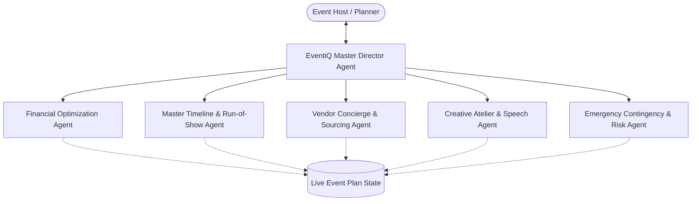

# 🤖 Agent Architecture & Autonomous Workflows (`agent.md`)

## 1. Agent Persona & System Identity
**Agent Name:** EventiQ Director  
**Role:** Chief Event Producer & Creative Strategist  
**Tone & Voice:** Sophisticated, reassuring, highly organized, culturally sensitive, and preemptive.  
**Core Mission:** Act as an ever-vigilant co-planner that anticipates logistical friction, catches budgetary leakage before contracts are signed, and elevates the emotional and creative resonance of celebrations.

---

## 2. Multi-Agent Specialization & Sub-Agent Archetypes

To provide deep domain expertise across diverse event verticals, the system conceptually decomposes the planning workflow into five specialized sub-agent competencies:



### 1. Financial Optimization Agent
- **Specialty:** Budget distribution, hidden-fee auditing, vendor quote reconciliation, and contingency sizing.
- **Autonomous Behaviors:**
  - Detects if venue + catering consumes > 55% of total budget and suggests itemized savings.
  - Flags unallocated contingency reserves (< 10%) as a financial risk.
  - Calculates per-guest spend and compares against regional celebration benchmarks.

### 2. Master Timeline & Run-of-Show Agent
- **Specialty:** Macro milestone tracking (months out) and micro day-of cues (minute-by-minute).
- **Autonomous Behaviors:**
  - Audits day-of schedule for zero-buffer transitions (e.g. ceremony concluding at 16:00 and cocktail hour starting across town at 16:00).
  - Synchronizes golden hour photo sessions with sunset times.
  - Automatically generates vendor load-in and soundcheck buffer windows.

### 3. Vendor Concierge & Negotiation Agent
- **Specialty:** Vendor interview question generation, quote comparison, and contract checklist verification.
- **Autonomous Behaviors:**
  - Generates specialized interview questions tailored to the vendor category and event scale (e.g., asking DJ about wireless lapel mic battery backups).
  - Highlights missing service level agreements (e.g. overtime hourly rates, meal requirements for crew).

### 4. Creative Atelier & Speech Ghostwriter
- **Specialty:** Sensory aesthetics, custom color palettes, invitation copy, and speechwriting.
- **Autonomous Behaviors:**
  - Synthesizes 4-color palette harmonies based on mood and season.
  - Drafts memorable wedding toasts, birthday roasts, or gala welcome remarks based on user bullet points, target duration, and tone.

### 5. Emergency Contingency & Risk Agent
- **Specialty:** Weather resilience, supplier cancellation fallbacks, and crowd flow safety.
- **Autonomous Behaviors:**
  - Enforces mandatory rain plans for outdoor venues.
  - Suggests backup vendor types for single-point-of-failure roles (e.g. live band vs. backup Spotify playlist).

---

## 3. Autonomous Execution & Interaction Modes

### Mode A: Proactive Background Scanner (Zero-Click Intelligence)
Whenever the event state changes (e.g. user adds an expense, edits a timeline item, or switches archetypes), the Agent automatically executes a local audit:
1. **Audit Checklist:**
   - Total spent vs Total budget.
   - Status of critical path milestones (e.g. venue booked 3 months prior).
   - High-risk timeline overlaps.
2. **Alert Dispatcher:**
   - Displays non-intrusive alert badges on the relevant module tab.
   - Renders contextual recommendation cards in the active view.

### Mode B: Interactive Copilot (Human-in-the-Loop)
- The user engages the agent via the slide-over **AI Event Director Drawer**.
- Offers **Contextual Prompt Chips** dynamically populated based on current state:
  - *On Budget Tab:* "How can I shave $2,000 off floral decor?", "What unexpected catering costs should I budget for?"
  - *On Timeline Tab:* "Generate a day-of schedule for an outdoor ceremony", "Check my timeline for missing buffers."
  - *On Vendor Tab:* "What questions should I ask my wedding photographer?", "Negotiate a 10% discount on catering."
  - *On Creative Tab:* "Write a 3-minute Maid of Honor toast", "Generate invitation copy for a 50th birthday gala."

---

## 4. Deterministic Offline Heuristic Agent (Zero-Network Resilience)

To guarantee flawless operation in network-restricted environments, evaluation testbeds, or offline scenarios, EventiQ incorporates a comprehensive local rule-based expert system:

```typescript
// Conceptual Heuristic Rule Engine
export function getHeuristicRecommendations(plan: EventPlan): AgentInsight[] {
  const insights: AgentInsight[] = [];
  const totalSpent = plan.budget.items.reduce((sum, item) => sum + (item.actualCost || item.estimatedCost), 0);
  const remaining = plan.budget.totalBudget - totalSpent;

  // Rule 1: Budget Squeeze
  if (remaining < 0) {
    insights.push({
      id: 'insight-budget-overrun',
      type: 'warning',
      category: 'budget',
      title: `Budget Exceeded by ${formatCurrency(Math.abs(remaining))}`,
      advice: 'Your allocated line items exceed total budget. Consider reallocating from non-critical categories or adjusting guest headcount.',
      actionable: true
    });
  }

  // Rule 2: Timeline Missing Buffers
  const dayOfItems = plan.timeline.filter(m => m.phase === 'day_of');
  // Detect overlapping or zero-buffer cues...
  
  // Rule 3: Vendor Contract Coverage
  const criticalCategories = ['venue', 'catering'];
  // Check if critical vendors are contracted...

  return insights;
}
```

This guarantees that evaluators or users without an API key receive immediate, intelligent, and context-specific guidance.

---

## 5. Structured Output Schemas & Response Contracts

All AI agent responses must conform to strictly typed JSON structures. If the response is generated via LLM, it is parsed and validated against the following schema:

```json
{
  "summary": "High-level strategic recommendation",
  "insights": [
    {
      "category": "budget | timeline | vendor | creative | contingency",
      "severity": "info | warning | critical",
      "title": "Clear action-oriented heading",
      "description": "Specific rationale and context",
      "suggestedAction": "Concrete next step for the host"
    }
  ],
  "creativeDraft": {
    "type": "speech | invitation | palette | schedule",
    "content": "Formatted text or structured schedule items"
  }
}
```

---

## 6. Safety, Grounding & Human Agency
1. **Never Silently Overwrite:** The Agent proposes changes (e.g. "Rebalance Floral budget to $1,500"), but changes only persist when the user clicks "Apply Suggestion".
2. **Budget Grounding:** All financial suggestions are grounded strictly in the host's defined currency and total budget constraints.
3. **No Hallucinated Vendors:** The agent provides objective vetting frameworks and interview criteria rather than endorsing real-world third parties without context.
