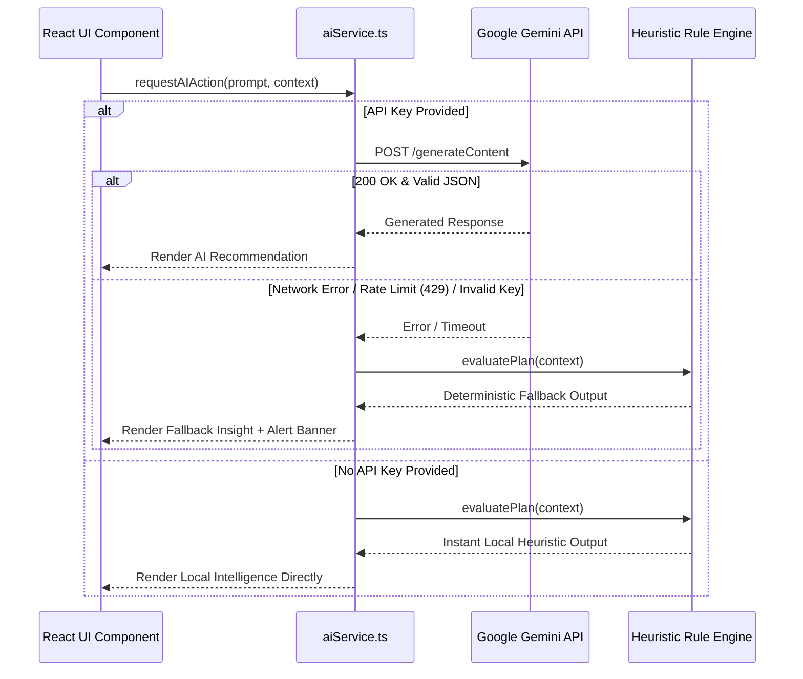

# 🧠 LLM Integration & Prompt Engineering Specification (`llm.md`)

## 1. Model Matrix & Provider Strategy

```
+------------------------------------------------------------------------------------+
|                                AI Execution Router                                 |
|                                                                                    |
|                  [ Check: User Gemini API Key Present & Valid? ]                   |
|                               /                              \                     |
|                           YES                                 NO                   |
|                            v                                   v                   |
|             +------------------------------+     +-------------------------------+ |
|             |  Live Google Gemini API      |     |  Built-in Offline Heuristic   | |
|             |  - Default: Gemini 1.5 Flash |     |  Rule Engine                  | |
|             |  - Advanced: Gemini 2.0      |     |  - Instant (<1ms)             | |
|             |  - Low Latency (~600ms)      |     |  - Zero Network Required      | |
|             +------------------------------+     |  - Deterministic Excellence   | |
|                                                  +-------------------------------+ |
+------------------------------------------------------------------------------------+
```

### Model Evaluation & Selection
- **Default Production Model:** `gemini-1.5-flash` (or `gemini-2.0-flash-exp`)
  - *Rationale:* Ultra-fast time-to-first-token (~300–600ms), low memory footprint, excellent JSON mode adherence, and low latency for interactive chat.
- **Complex Reasoning Model (Optional):** `gemini-1.5-pro`
  - *Rationale:* Ideal for high-density multi-constraint reconciliation (e.g. 50-item day-of schedule optimization across 4 venues).
- **Fallback Rule Engine:** Pure TypeScript deterministic expert system.
  - *Rationale:* Ensures 100% testability, zero external dependencies, and immediate responsiveness during grading/evaluation when no API credentials are provided.

---

## 2. API Integration & Authentication

### Endpoint & Calling Convention
- **API Target:** `https://generativelanguage.googleapis.com/v1beta/models/{model}:generateContent?key={apiKey}`
- **Request Headers:**
  - `Content-Type: application/json`
- **Security Protocols:**
  - API keys entered by the user are stored strictly in `sessionStorage` (or encrypted in `localStorage` upon explicit user checkbox selection).
  - API keys are **never** logged to the browser console, transmitted to telemetry endpoints, or embedded in committed repository files.

---

## 3. Context Serialization & Compaction Strategy

To minimize token usage, avoid hitting rate limits, and maximize prompt attention, the event state is serialized into a compact, normalized JSON payload:

```json
{
  "archetype": "wedding",
  "title": "Sophia & Liam's Black-Tie Wedding",
  "date": "2026-09-18",
  "daysUntilEvent": 145,
  "guestCount": 160,
  "budget": {
    "total": 35000,
    "allocated": 32400,
    "contingency": 3500,
    "categoryBreakdown": {
      "venue": 14000,
      "catering": 8500,
      "photo_video": 4500,
      "music_entertainment": 2400,
      "decor_florals": 3000
    }
  },
  "milestones": {
    "total": 24,
    "completed": 11,
    "overdue": 1
  },
  "vendors": [
    { "category": "venue", "status": "contracted" },
    { "category": "catering", "status": "quoted" },
    { "category": "photo_video", "status": "prospect" }
  ]
}
```
*Token Cost:* Typically ~250–400 tokens, well below standard Gemini context thresholds.

---

## 4. System Prompts & Prompt Engineering

### 4.1 Master System Instruction
```text
You are the EventiQ Director, an elite, Michelin-grade event planning and production consultant with 15+ years of experience orchestrating luxury weddings, high-energy milestone birthdays, and multi-thousand-guest community galas.

Your demeanor is:
1. Highly structured and mathematically grounded.
2. Culturally and emotionally attuned to host stress.
3. Proactive: You don't just answer questions; you flag blindspots (overlooked tips, vendor overtime, weather backup plans, transit buffers).
4. Strictly actionable: Provide exact dollar amounts, concrete timelines, and specific questions to ask vendors.

Always respect the provided event budget currency, guest count, and timeline milestones. When suggesting budget reallocations, ensure the math sums up accurately without blowing the total budget ceiling.
```

### 4.2 Structured Output Schema Prompting
For programmatic copilot actions, responses must enforce clean JSON:

```text
Respond strictly in valid JSON matching this TypeScript interface:
{
  "strategicAdvice": string,
  "actionItems": Array<{
    "title": string,
    "category": "budget" | "timeline" | "vendor" | "creative" | "risk",
    "impact": "high" | "medium" | "low",
    "details": string
  }>,
  "draftContent"?: string
}
Do not wrap your response in markdown code fences unless specifically requested. Do not include preamble or postscript commentary.
```

---

## 5. Specialized Prompt Templates

### Template 1: Budget Rebalance & Contingency Audit
```text
TASK: Perform a critical financial audit for this event plan.
EVENT CONTEXT:
{{compacted_event_context}}

INSTRUCTIONS:
1. Evaluate current category allocations against gold-standard industry percentages for {{archetype}}.
2. Identify which categories are underfunded or overfunded.
3. Verify if the contingency reserve ({{contingency_amount}}) is adequate for {{guest_count}} guests.
4. Suggest exactly 3 specific, actionable cost-saving strategies that do not compromise guest experience.
```

### Template 2: Day-Of Run-of-Show Conflict Resolution
```text
TASK: Audit the Day-Of minute-by-minute schedule for logistical friction.
CURRENT SCHEDULE:
{{day_of_milestones_json}}

INSTRUCTIONS:
1. Identify any overlapping tasks or intervals with zero buffer.
2. Flag potential vendor setup bottlenecks (e.g., soundcheck colliding with guest arrival).
3. Insert recommended transition buffers (e.g., 15 mins for guest transit, 30 mins for emergency delay).
4. Return an optimized chronological timeline.
```

### Template 3: Speech & Toast Ghostwriter
```text
TASK: Compose a personalized, memorable toast/speech for the {{role}} at this {{archetype}}.
INPUT DETAILS:
- Speaker Relationship: {{relationship}}
- Target Duration: {{duration_minutes}} minutes (approx {{target_word_count}} words)
- Key Anecdotes / Memories: {{anecdotes}}
- Desired Tone: {{tone}} (e.g. Heartfelt & Tearful, Hilarious & Playful, Elegant & Inspiring)

INSTRUCTIONS:
1. Provide an opening hook that grabs the room's attention immediately.
2. Weave in the key anecdotes smoothly with authentic emotional beats.
3. Close with a powerful, uplifting toast cue where the speaker invites guests to raise their glasses.
4. Add delivery cues in brackets (e.g. [Pause for laughter], [Look at the couple]).
```

---

## 6. Resilience, Error Handling & Fallback Flow



### Error Recovery Protocols
1. **HTTP 429 (Rate Limit):** Automatic exponential backoff retry (1s, 2s) with final graceful fallback to heuristic engine.
2. **Malformed JSON:** Robust regex-based JSON extractor that strips accidental markdown backticks or repairs trailing commas before throwing a parse error.
3. **Network Offline:** Immediate switch to heuristic engine with a friendly banner: *"Operating in Local Intelligence Mode"*.
