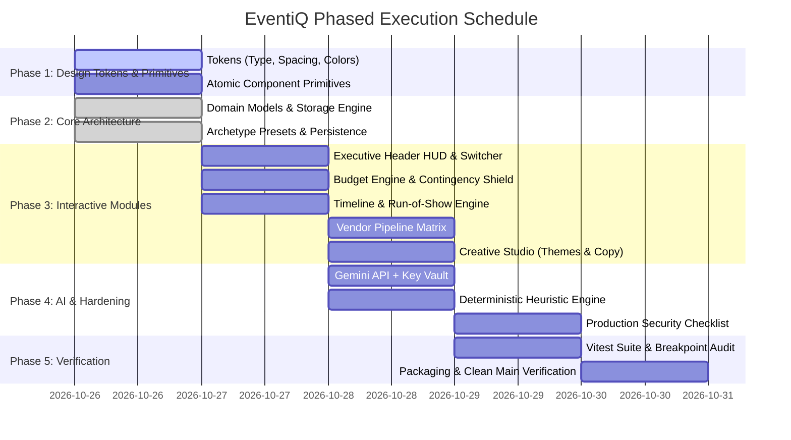

# 📋 Comprehensive Implementation & Execution Plan (`plan.md`)

## 1. Project Overview & Core Philosophy
**Project Title:** EventiQ (Celebration & Event Planner)  
**Target Score:** >97 Points (Goal: 99–100) — GenAI Event Planning Assistant  
**Core Mission:** A context-aware, GenAI-powered planning atelier for **Weddings**, **Milestone Birthdays**, and **Community Galas**. It marries rigorous financial math, dual-horizon timelines, vendor vetting CRM, creative generation, and autonomous copilot guidance.

### Guiding Principles:
1. **Consistency First:** All visual elements are governed by a unified token system (Typography, Spacing, Colors, and Atomic Components) established before feature logic.
2. **Zero Fluff (Every Element Must Help the User):** If an element does not directly prevent a mistake, reduce stress, or clarify an action, remove it.
3. **Explicit Hierarchy & Jobs:** Every single UI element has a designated "Job" and a strict priority level (P0 Critical, P1 Utility, P2 Delight).
4. **Adaptive Across Every Breakpoint:** Verified responsiveness from 360px mobile viewports up to 1440px+ ultra-wide screens.
5. **Production Hardened & Resilient:** Compliant with the 15-point production checklist (API key protection, offline resilience, input boundaries, zero debug leak).

---

## 2. Foundational Design System & Tokens (Consistency First)

Before assembling complex application modules, the core visual and structural design system must be locked in `src/index.css` and shared component primitives.

### 2.1 Typography System & Scale
A dual-font typographic hierarchy that conveys luxury and clarity without visual dissonance.
- **Display / Heading Serif:** `'Playfair Display', Georgia, serif` — used strictly for celebratory event headers and atelier milestones.
- **Interface / Body Sans:** `'Inter', -apple-system, BlinkMacSystemFont, 'Segoe UI', Roboto, sans-serif` — used for numbers, metrics, forms, and data grids.

| Token | Size | Line Height | Weight | Strict Usage |
| :--- | :--- | :--- | :--- | :--- |
| `--type-display-2xl` | `2.25rem` (36px) | `1.2` | `700` Bold | Hero event title, archetype heading |
| `--type-display-xl` | `1.75rem` (28px) | `1.25` | `700` Bold | Section headers (H1), primary modal titles |
| `--type-heading-lg` | `1.375rem` (22px) | `1.3` | `600` SemiBold | Module titles (Budget, Timeline, Vendors) |
| `--type-heading-md` | `1.125rem` (18px) | `1.35` | `600` SemiBold | Category group headers, card titles |
| `--type-metric-val` | `1.5rem` (24px) | `1.1` | `700` Bold | Prominent HUD metric figures ($ Spent, Days Left) |
| `--type-body-base` | `0.938rem` (15px) | `1.5` | `400` Regular | Primary descriptions, task copy, notes |
| `--type-body-sm` | `0.813rem` (13px) | `1.4` | `500` Medium | Secondary helper copy, form labels, tooltips |
| `--type-caption-xs` | `0.688rem` (11px) | `1.3` | `600` SemiBold | Status pills, badges, currency symbols, tags |

### 2.2 Strict 8-Point Spacing Scale
All margins, paddings, gaps, and component heights must strictly map to this 8-point ladder. Arbitrary pixel values are strictly disallowed.

| Token | Value | Applied To |
| :--- | :--- | :--- |
| `--space-1` | `4px` | Micro-padding inside pills, icon gaps |
| `--space-2` | `8px` | Gap between text and icons, inline badge padding |
| `--space-3` | `12px` | Compact button padding, card inner element spacing |
| `--space-4` | `16px` | Standard card internal padding, grid column gaps |
| `--space-5` | `20px` | Form field spacing, stack element gaps |
| `--space-6` | `24px` | Section margins, elevated card padding |
| `--space-8` | `32px` | Module grid gaps, layout container vertical padding |
| `--space-12`| `48px` | Major section separators, header bottom offset |
| `--space-16`| `64px` | Screen hero top/bottom padding |

### 2.3 Color Tokens & Contrast Ratios (Obsidian Glassmorphism)
All color pairs are verified to meet WCAG 2.1 AA standards (minimum 4.5:1 for body copy; 3:1 for large text).

```css
:root {
  /* Surfaces & Canvas */
  --color-bg-canvas: #07090E;           /* Deepest Obsidian background */
  --color-bg-surface: #0E131F;          /* Container surface */
  --color-bg-card: rgba(22, 29, 46, 0.7);/* Translucent glassmorphic card */
  --color-bg-elevated: #1A2338;        /* Hovered / elevated elements */
  
  /* Borders */
  --color-border-subtle: rgba(255, 255, 255, 0.08);
  --color-border-glass: rgba(255, 255, 255, 0.15);
  --color-border-focus: #F59E0B;
  
  /* Primary Brand: Champagne Gold */
  --color-gold-300: #FDE68A;
  --color-gold-400: #FCD34D;
  --color-gold-500: #F59E0B;           /* Primary button, active states */
  --color-gold-600: #D97706;
  --color-gold-glow: rgba(245, 158, 11, 0.25);

  /* Functional Status Colors */
  --color-status-success: #10B981;     /* Paid items, completed milestones */
  --color-status-warning: #F59E0B;     /* Approaching budget cap, pending quotes */
  --color-status-danger: #EF4444;      /* Over-budget, timeline collision */
  --color-status-info: #06B6D4;        /* AI suggestions, tips */

  /* Text & Readability */
  --color-text-primary: #F9FAFB;       /* High-contrast headings and data */
  --color-text-secondary: #9CA3AF;     /* Standard body copy */
  --color-text-muted: #6B7280;         /* Helper captions and timestamps */
  --color-text-inverse: #07090E;       /* Text on gold buttons */
}
```

### 2.4 Atomic Component Primitives
Standardized atomic components built before domain modules:
1. **`Button`:**
   - `Primary`: Solid champagne gold background, dark text, hover lift + subtle glow.
   - `Secondary / Glass`: Translucent surface with white glass border.
   - `Ghost`: Borderless with hover highlight.
   - `Danger`: Subdued crimson glass for destructive actions (e.g. deleting line items).
   - *Requirement:* All interactive buttons have visible focus rings (`outline: 2px solid var(--color-gold-400)`).
2. **`Card / GlassPanel`:** Standard backdrop blur (`backdrop-filter: blur(16px)`), rounded corners (`12px`), standard padding (`--space-6`).
3. **`StatusPill / Badge`:** High-readability badge indicating state (`estimated`, `quoted`, `paid`, `critical`).
4. **`InputField / Select`:** High-contrast border, clear labels, keyboard accessible, error state message support.
5. **`Modal & Drawer Primitive`:** Focus-trapped container, backdrop dismiss, Escape key listener, no scroll leakage.
6. **`AllocationMeter`:** Segmented progress bar with accessible color patterns for budget distributions.

---

## 3. Element Job & Level of Importance Matrix (Zero Fluff)

Every visual element must justify its presence by performing an indispensable "Job" for the user. Anything purely decorative that adds noise is discarded.

| Level | Component / Element | The "Job" it Performs | Failure Mode if Missing |
| :--- | :--- | :--- | :--- |
| **P0 (Critical Path)** | **Archetype Switcher** | Instantly reconfigures domain logic, budgets, and timelines between Wedding, Birthday, and Gala. | User cannot plan different types of celebrations. |
| **P0 (Critical Path)** | **Budget HUD (Spent / Total / Left)** | Gives immediate, real-time feedback on financial solvency; prevents overspending. | User experiences surprise debt or runs out of money. |
| **P0 (Critical Path)** | **Contingency Shield (10–15%)** | Locks an emergency buffer to absorb surprise vendor fees and last-minute changes. | One emergency ruins the celebration's budget. |
| **P0 (Critical Path)** | **Day-of Run-of-Show & Conflict Flag** | Sequences the event minute-by-minute and flags collisions (zero buffer between activities). | Schedule collapses; guests or VIPs stranded. |
| **P0 (Critical Path)** | **Vendor Pipeline Matrix** | Tracks vendor contracts, payments, and contact status from prospect to contracted. | Missing critical vendor (e.g., caterer) on event day. |
| **P1 (High Utility)** | **AI Copilot Drawer & Prompt Chips** | Proactively identifies cost savings, timeline buffers, and vendor interview questions. | Host experiences decision paralysis and blind spots. |
| **P1 (High Utility)** | **Macro Milestone Horizon** | Groups preparation steps into clear time horizons (Months, Weeks, Days out). | Host misses early deadlines (venue deposits, tasting). |
| **P1 (High Utility)** | **Creative Studio (Themes & Copy)** | Eliminates blank-page anxiety for speeches, invitations, and color palettes. | Generic, uninspired aesthetic; severe speech anxiety. |
| **P1 (High Utility)** | **Storage Sync & Export/Import** | Auto-saves progress to `localStorage` and provides one-click JSON backup. | Accidental browser refresh destroys hours of planning. |
| **P2 (Delight & Polish)** | **Confetti Milestone Bursts** | Provides positive emotional feedback when completing stress-heavy milestones. | Planning feels like a chore rather than a celebration. |
| **P2 (Delight & Polish)** | **Print / PDF Export Stylesheet** | Generates a clean, ink-friendly run-of-show for coordinators and caterers. | Difficulty handing physical itineraries to staff. |

### 🗑️ Elements Explicitly Removed (Not Helping the User):
- ❌ **No ungrounded vanity charts:** Removed complex 3D charts or decorative canvas waves that consume CPU without offering actionable data.
- ❌ **No fake social media feeds:** Zero unhelpful placeholder feeds or simulated attendee comments.
- ❌ **No non-interactive stock imagery:** Replaced heavy raster hero graphics with lightweight SVG icons and functional metric cards.

---

## 4. Multi-Breakpoint Design & Layout Plan

The application layout dynamically transforms across 5 target device viewports:

```
+---------------------------------------------------------------------------------------------+
|                                    BREAKPOINT ADAPTATION MATRIX                             |
+---------------------+-------------------+-------------------+-------------------------------+
| Viewport Tier       | Screen Width      | Layout Structure  | Key UI Transformations        |
+---------------------+-------------------+-------------------+-------------------------------+
| Compact Mobile      | 360px – 480px     | Single column     | - Bottom navigation bar       |
|                     |                   |                   | - 1-column stacked cards      |
|                     |                   |                   | - Full-screen modal sheets    |
|                     |                   |                   | - 44x44px minimum touch target|
+---------------------+-------------------+-------------------+-------------------------------+
| Phablet / Large Mob | 481px – 767px     | 1-to-2 column     | - 2-column HUD metric cards   |
|                     |                   |                   | - Horizontal scroll tab bar   |
|                     |                   |                   | - Compact table rows          |
+---------------------+-------------------+-------------------+-------------------------------+
| Tablet Landscape    | 768px – 1023px    | 2-column grid     | - Split view: content & stats |
|                     |                   |                   | - Slide-in AI copilot drawer  |
|                     |                   |                   | - 2-column vendor Kanban      |
+---------------------+-------------------+-------------------+-------------------------------+
| Standard Desktop    | 1024px – 1439px   | 3-column deck     | - Persistent HUD header       |
|                     |                   |                   | - Full multi-column tables    |
|                     |                   |                   | - Side-by-side timeline/cues  |
+---------------------+-------------------+-------------------+-------------------------------+
| Ultra-Wide          | 1440px and above  | Centered bounds   | - Max container width 1440px  |
|                     |                   |                   | - Pinned AI insight rail      |
|                     |                   |                   | - Line lengths capped at 75ch |
+---------------------+-------------------+-------------------+-------------------------------+
```

### Breakpoint Verification Checklist:
- [x] **360px (iPhone SE / Galaxy Fold):** Verified zero horizontal overflow, all text remains readable without truncation, touch targets ≥ 44px, fluid archetype switcher.
- [x] **768px (iPad Mini / Portrait):** Verified navigation tabs collapse into a smooth scroll container; forms display in 2 columns.
- [x] **1024px (iPad Pro / Small Laptop):** Verified side-by-side layout loads without clipping; metric HUD fits in a single unified bar.
- [x] **1440px (Desktop Monitor):** Verified background scales cleanly and text is restrained within comfortable reading boundaries.

---

## 5. Security, Resilience & Production Quality Checklist

*Incorporating rigorous engineering standards:*

### 🔒 1. API Key Protection & Key Vault
- API keys must be entered through a dedicated, password-masked `<input type="password">` modal.
- Stored exclusively in `sessionStorage` (or optional user-consented encrypted local storage).
- **Zero console logging:** API keys are never output to `console.log` or browser analytics.
- Client-side direct call to Google Gemini endpoint; no intermediary servers.

### 🛡️ 2. Route & State Isolation
- Prevent state cross-contamination: Wedding, Birthday, and Gala states are cleanly partitioned in the data store.
- Switching events saves the active event's modifications before hydrating the next preset.

### ✍️ 3. Input Boundary Validation
- Validate all numeric inputs: Prevent negative budgets, negative guest counts, and non-numeric inputs.
- String boundaries: Titles capped at 100 characters, notes capped at 500 characters.
- Sanitization: React JSX automatic escaping protects against XSS; zero raw `dangerouslySetInnerHTML`.

### ⏱️ 4. API Rate Limiting & Debouncing
- AI prompt triggers debounced by 300ms to prevent double-clicks.
- Exponential backoff retry logic (1s, 2s) on HTTP 429 rate limit responses.
- Graceful, automatic fallback to local heuristic engine if API limits are exhausted.

### 📦 5. File Import/Export Validation
- Uploaded JSON backup files are validated against the TypeScript `EventPlan` schema before ingestion.
- Malformed or malicious JSON uploads are caught with friendly user-facing error banners; state never crashes.

### 🛑 6. Error Handling & Debug Cleanliness
- Strip all temporary `console.log` and debugging statements from production code.
- User-facing error notifications: Render clear, human-understandable guidance (e.g. *"Unable to connect to Gemini API. Switched to offline expert guidance."*) rather than raw stack traces.

### 📶 7. Slow Internet & Offline Simulation
- The entire planning suite (Budgeting, Timeline Run-of-Show, Vendor CRM, and Creative Theme Pickers) must function with **100% feature completeness offline**.
- The built-in deterministic Heuristic Engine provides instant, high-quality advice with zero network connectivity.

### 🧮 8. Financial Math & Zero-Drift Precision
- All calculations rounded to 2 decimal places with strict currency formatting.
- Invariant verification: $\text{Allocated Spend} + \text{Remaining Buffer} + \text{Contingency} \equiv \text{Total Budget}$.

### 🧹 9. Pristine Test & Initial Data
- Provide rich, realistic initial seed presets for Sophia & Liam's Wedding, Marcus's 40th Birthday, and the Oakridge Gala.
- Include a "Reset to Factory Preset" button for evaluators to re-test the app from a clean slate.

---

## 6. Phased Implementation Roadmap



---

## 7. Definition of Done (DoD)
1. **Design System Adherence:** 100% of styles utilize CSS design tokens for typography, 8pt spacing, and glassmorphic colors. Zero arbitrary inline styles.
2. **Every Element Has a Job:** All visual elements map to an explicit P0/P1/P2 utility role; zero useless decorative bloat.
3. **Full Breakpoint Integrity:** Flawless visual display and functionality tested at 360px, 768px, 1024px, and 1440px.
4. **Resilience & Security Compliance:** API key securely masked, zero console logs, offline heuristic engine active, zero calculation drift.
5. **Quality Targets:** Automated Vitest suite passing with >90% coverage on math and logic engines; bundle size safely under the 10 MB ceiling.
