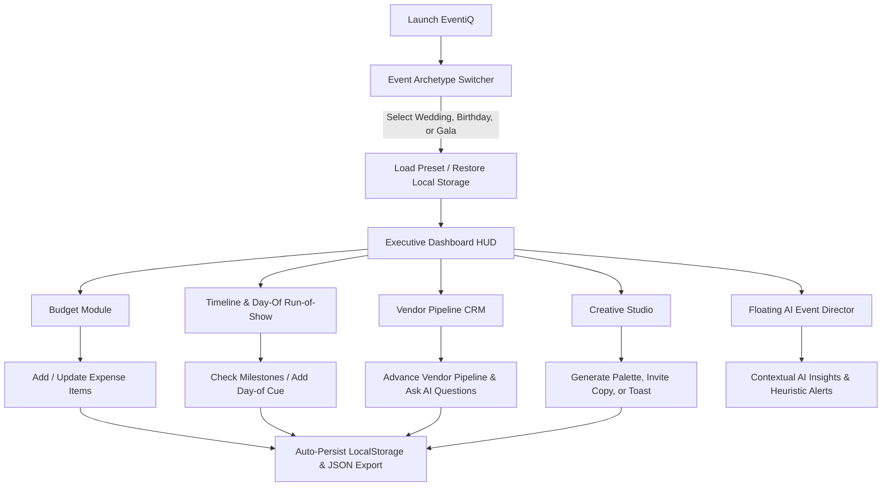

# 📄 Product Requirements Document (`prd.md`)

## 1. Executive Summary & Vision
**Product Name:** EventiQ (Celebration & Event Planner)  
**Vision:** An intelligent, context-aware GenAI event management platform that transforms chaotic, high-stress event planning into an elegant, mathematically sound, and creatively inspiring journey for hosts of all experience levels.

Organizing celebrations (weddings, milestone birthdays, and community festivals/galas) suffers from four distinct failure modes:
1. **Financial Drift:** Unrealistic allocations, surprise gratuities, and unbudgeted emergency expenses.
2. **Temporal Chaos:** Desynchronized countdown checklists and fragile, unbuffered day-of schedules.
3. **Vendor Uncertainty:** Lack of structured vetting, negotiation frameworks, and contract clarity.
4. **Creative Impasse:** Generic themes, stale invitation copy, and anxiety-inducing speechwriting.

EventiQ solves these challenges by combining mathematical rigor, dual-horizon timelines, vendor evaluation CRM, generative creative aids, and a proactive AI Event Director.

---

## 2. Target Personas & Event Archetypes

### Persona 1: The Couple (Weddings & Formal Receptions)
- **Profile:** High stakes, emotionally charged, multi-stakeholder approval, large budgets ($15k–$80k+), 100–300+ guests.
- **Pain Points:** Hidden venue fees, family seating drama, speech anxiety, fear of day-of schedule collapse.
- **Key Needs:** Rigorous category allocations, buffer-protected run-of-show, emotional vows/toasts assistance, vendor milestone payment tracking.

### Persona 2: The Host / Parent (Milestone Birthdays & Anniversaries)
- **Profile:** Energetic, vibe-centric, medium budgets ($3k–$15k), 30–100 guests.
- **Pain Points:** Creating a cohesive theme, engaging guests across age groups, coordinating surprises and games.
- **Key Needs:** Curated sensory color palettes, playlist and theme suggestions, quick RSVP tracking, signature cocktail/mocktail recipe prompts.

### Persona 3: The Committee Chair (Community Galas & Cultural Festivals)
- **Profile:** Multi-stakeholder, volunteer-driven, high guest volume (200–1000+), sponsorship-supported.
- **Pain Points:** Stage timeline drift, volunteer task accountability, permit requirements, strict contingency budgets.
- **Key Needs:** Minute-by-minute stage cue sheets, vendor deliverable statuses, safety buffer alerts, sponsorship expense auditing.

---

## 3. Product Epics & Detailed Requirements

### Epic 1: Intelligent Dynamic Budgeting & Financial Shield
- **Req 1.1 — Archetype-Aware Allocation:** When switching event types, the system automatically applies industry-standard percentage benchmarks:
  - *Wedding:* Venue & Catering (45%), Photo/Video (12%), Decor/Floral (10%), Music (8%), Attire (8%), Favors (3%), Contingency (14%).
  - *Birthday:* Food & Drinks (40%), Venue (25%), Entertainment (15%), Decor/Cake (10%), Contingency (10%).
  - *Community Gala:* Venue & Staging (35%), Catering & Hospitality (25%), Marketing & Permits (15%), Performers (15%), Contingency (10%).
- **Req 1.2 — Contingency Shield:** An explicit, locked reserve pool (10–15%) protecting the host against last-minute surge fees or weather contingencies.
- **Req 1.3 — Real-Time Rebalancing:** As users add or adjust line items, visual indicators warn if a category exceeds its allocation target.
- **Req 1.4 — Payment Status Lifecycle:** Track each item across `Estimated` ➔ `Quoted` ➔ `Paid` with total paid vs. remaining obligations.

### Epic 2: Dual-Horizon Timeline & Day-Of Run-of-Show
- **Req 2.1 — Macro Milestone Horizon:** Countdown milestones categorized by time buckets:
  - *Macro (6–12 months out):* Core venue deposit, date locking, guest list framing.
  - *Intermediate (2–8 weeks out):* Catering tasting, invitations dispatched, attire fittings.
  - *Micro (1–7 days out):* Final headcounts, vendor confirmation calls, pack emergency kit.
- **Req 2.2 — Micro Day-Of Run-of-Show:** Chronological, minute-by-minute schedule from vendor load-in to cleanup.
- **Req 2.3 — Conflict & Buffer Detection:** Highlights missing buffers between key events (e.g. ceremony end to reception start without transit window).
- **Req 2.4 — Task Delegation:** Assign tasks to specific individuals (e.g. "Maid of Honor", "Stage Lead", "Catering Manager").

### Epic 3: Vendor Pipeline Matrix & AI Interview Guides
- **Req 3.1 — Kanban Pipeline:** Manage vendors across 5 statuses: `Prospect` ➔ `Contacted` ➔ `Quoted` ➔ `Contracted` ➔ `Declined`.
- **Req 3.2 — Multi-Factor Scorecard:** Rate vendors on Cost, Reliability, and Responsiveness with direct contract link and notes.
- **Req 3.3 — AI Interview Guides:** Provide tailored negotiation and vetting questions for each vendor category (e.g. asking a DJ about backup sound systems, asking a caterer about dietary allergen controls).

### Epic 4: Sensory Creative Studio & Speechwriter
- **Req 4.1 — Theme & Color Harmonizer:** Hex-coded color palettes tailored to event types (e.g., "Champagne & Emerald", "Velvet Noir", "Golden Sunburst").
- **Req 4.2 — Invitation & Announcement Drafter:** Generates ready-to-use copy across 4 tones: Elegant, Warm & Joyful, Formal Black-Tie, or Playful.
- **Req 4.3 — Speech & Toast Ghostwriter:** Generates speech frameworks for Best Man, Maid of Honor, Host, or Committee Chair based on user-supplied memories, relationship depth, and duration (1 min, 3 min, 5 min).

### Epic 5: Context-Aware GenAI Copilot & Contingency Alert Engine
- **Req 5.1 — Event State Awareness:** The AI automatically receives the current event parameters (budget total, remaining balance, days to event, incomplete milestones, active vendors).
- **Req 5.2 — Dual-Mode Execution:**
  - *Live Mode:* Connects directly to Google Gemini models (1.5 Flash / 2.0 Flash) using a secure user-provided key.
  - *Offline Heuristic Mode:* Zero network dependency; produces instant, rich, actionable advice using local heuristics.
- **Req 5.3 — Proactive Contingency Warnings:** Alerts users to anomalies (e.g., "Photography budget is 22% over benchmark", "No rain backup plan identified for outdoor ceremony").

---

## 4. User Journey & Information Architecture

---

## 5. Non-Functional Requirements (NFRs)

| Dimension | Specification | Verification Method |
| :--- | :--- | :--- |
| **Performance** | Initial load under 800ms; reactive UI state updates < 16ms (60fps). | Chrome DevTools Lighthouse audit. |
| **Repository Size** | Strict limit < 10 MB total repository size. | Git repository size check (`du -sh .git`). |
| **API Key Privacy** | Key stays in browser memory/session; never transmitted to telemetry or backend servers. | Network tab inspection. |
| **Accessibility** | WCAG 2.1 AA compliance; contrast ratio ≥ 4.5:1, semantic HTML, visible focus states. | Axe accessibility tools and keyboard walkthrough. |
| **Reliability** | Zero crash states on malformed JSON import or network disconnect; seamless heuristic fallback. | Automated Vitest test suite. |
| **Data Portability** | One-click JSON export/import and browser print stylesheet for PDF generation. | Manual export/import roundtrip verification. |

---

## 6. Success Metrics & Scoring Alignment
- **Evaluation Target:** > 97 points (Target: 99–100).
- **Rubric Dimensions:**
  - *Domain Completeness (25%):* Deep coverage of budget, timeline, vendors, creative assets.
  - *AI Relevance & Depth (25%):* Actionable, high-context AI advice (both live & offline).
  - *Engineering Rigor & Quality (20%):* Type safety, zero console errors, modular code.
  - *UX/UI Aesthetics (20%):* Modern Obsidian Glassmorphism, intuitive navigation, micro-interactions.
  - *Testing & Compliance (10%):* Automated unit tests, <10MB size, single main branch.
